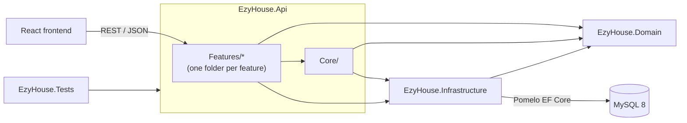
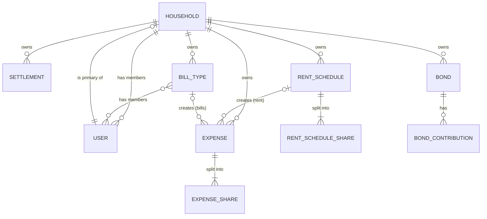

# EzyHouse Backend: Design

The EzyHouse backend is a C# ASP.NET Core Web API on **.NET 10**, backed by MySQL 8 through Entity
Framework Core. The React frontend talks to it over the REST contract in [API.md](../API.md).

**Status:** every API.md v5 endpoint is built and has been called over HTTP against MySQL with the
demo data; 124 NUnit tests pass. To run it, see [README.md](README.md). This document explains how
the code is organised and **why**, so anyone in the team can change it, or explain it in the demo.

## Contents

1. [Inputs](#1-inputs)
2. [Solution layout](#2-solution-layout)
3. [Packages and set-up](#3-packages-and-set-up)
4. [Data model](#4-data-model)
5. [Design decisions](#5-design-decisions)
6. [Endpoint rules](#6-endpoint-rules)
7. [Tests](#7-tests)
8. [Status and remaining work](#8-status-and-remaining-work)
9. [Risks and notes](#9-risks-and-notes)

---

## 1. Inputs

- **[API.md](../API.md) (v5) is the source of truth** for endpoints, request and response shapes,
  permissions and business rules. Where this document and API.md disagree, API.md wins. v5 replaced
  v4's separate rent periods, bills and furniture items with one expense model:
  - every cost is an expense tagged `rent`, `bills`, `groceries` or `furniture`
  - one balance per pair of people, from every expense and every settlement
  - no paid ticks; settlements of any amount pay down a pair's balance
  - rent schedules and bill types create their expenses in a background job
  - leaving is blocked only by debts
- **[specifications.md](../specifications.md)** supplies the tech stack: an ASP.NET Core Web API,
  MySQL through `Pomelo.EntityFrameworkCore.MySql` with EF Core Code First, NUnit, and the names
  `EzyHouseDbContext` and `EzyHouse.Tests`.
- **[Assignment2_Specification.pdf](../../Research/Assignment2_Specification.pdf)** supplies the
  marking requirements. The README's [technique table](README.md#where-to-find-each-marking-guide-technique)
  shows where each one is met.
- **[knowledge.md](../knowledge.md)** is the C# reference from the lectures.

### Parts of specifications.md that are not built

specifications.md describes an earlier design that API.md replaced. The frontend should follow
API.md, not specifications.md.

- **The `Flatmate` entity.** API.md has users and households instead. Its idea of expense
  subclasses survives: `RentExpense`, `BillExpense`, `GroceryExpense` and `FurnitureExpense` (5.4).
- **Room-size and percentage splits.** API.md allows only `equal` and `exact`.
- **PayID payment strings, CSV export, notifications (`INotifiable`), debt simplification and
  `GET /api/dashboard/summary`.** None of these are in API.md. The dashboard is built from existing
  endpoints.
- **The generic repository `IRepository<T>`.** Replaced by one repository per feature (5.7).

---

## 2. Solution layout

**Vertical feature slices on a shared Core.** Each feature of the app has one folder holding
everything it needs: controller, service, repository, DTOs and mappings. Inside a slice, the
familiar controller → service → repository flow still applies.

```text
Backend/
  README.md                  how to run it, and where each marking-guide technique is
  backend.md                 this document
  EzyHouse.slnx
  docker-compose.yml         MySQL 8 for development
  src/
    EzyHouse.Domain/         shared Core: entities, enums, interfaces, split / schedule / balance rules,
                             exceptions. References nothing else.
      Entities/  Enums/  Interfaces/  ValueObjects/  Splitting/  Scheduling/  Balances/
      Exceptions/  Extensions/
    EzyHouse.Infrastructure/ shared Core: EzyHouseDbContext, entity configurations, the migration
      Data/  Data/Configurations/  Migrations/
    EzyHouse.Api/
      Core/                  shared by every feature: current user, error handler, JSON settings,
                             [Money], shared DTOs and mappings, the schedule runner and its hourly
                             background job, household balances, SystemClock, DemoSeeder
      Features/
        Auth/  Households/  Expenses/  Balances/  Rent/  Bills/  Bonds/
          each: <X>Controller, I<X>Service + <X>Service, I<X>Repository + <X>Repository,
                <X>Dtos, <X>Mappings, <X>Feature (registers the slice's services)
      Program.cs
  tests/
    EzyHouse.Tests/          Domain/  Core/  Features/  Infrastructure/  Support/
```



Rules that keep the slices independent:

1. **A feature never references another feature's classes.** Anything two features need moves to
   Core. For example, `ShareDto` is used by Expenses and Rent, so it lives in `Api/Core/SharedDtos.cs`.
2. **Reading another feature's data goes through Core.** Balances, Rent, Bills and Households do
   this through `IHouseholdBalances` and `IScheduleRunner` in `Api/Core/`, never through another slice.
3. **One `DbContext`, one migration history.**

Why: a change to one feature touches one folder; the team can split work by feature with few merge
conflicts; each person can explain their own slice end to end in the individual demo. In the
marking guide's terms, this is "high cohesion, low coupling".

**Naming:** the folders are `Households` and `Bonds`, not singular. A namespace segment called
`Household` or `Bond` hides the entity class of the same name and gives compile error CS0118.

---

## 3. Packages and set-up

### Prerequisites

- **.NET 10 SDK.** Visual Studio 2022 can't build .NET 10 projects; use Visual Studio 2026, Rider,
  VS Code or the command line. Whether the lab PCs can build .NET 10 still needs checking (section 8).
- **Docker Desktop** for MySQL 8 (`docker-compose.yml`): database `ezyhouse`, user `ezyhouse`,
  password `admin123`, port 3306.

### NuGet packages

| Project | Package | Version |
|---|---|---|
| Infrastructure | `Pomelo.EntityFrameworkCore.MySql` | 9.0.0 |
| | `Microsoft.EntityFrameworkCore.Relational` | 9.0.0 |
| Api | `Microsoft.EntityFrameworkCore.Design` (for `dotnet ef`) | 9.0.0 |
| | `Microsoft.AspNetCore.Authentication.JwtBearer` | 10.0.12 |
| | `Microsoft.AspNetCore.OpenApi` | 10.0.12 |
| | `Swashbuckle.AspNetCore` (Swagger UI) | 10.3.0 |
| Tests | `NUnit` 4.3.2, `NUnit3TestAdapter` 5.0.0, `NUnit.Analyzers` 4.7.0, `Microsoft.NET.Test.Sdk` 17.14.0, `coverlet.collector` 6.0.4 | |
| | `Microsoft.EntityFrameworkCore.Sqlite` (in-memory test database) | 9.0.0 |

- **EF Core stays on 9.0.x on .NET 10.** Pomelo 9 is the newest MySQL provider and needs EF Core 9;
  every `Microsoft.EntityFrameworkCore.*` package must be the same 9.0.x version, or start-up fails
  with `MissingMethodException`.
- **No BCrypt package.** Passwords use ASP.NET's built-in `PasswordHasher<User>` (5.9).

### Configuration (`src/EzyHouse.Api/appsettings.json`)

- **`ConnectionStrings:EzyHouse`:** the MySQL database from `docker-compose.yml`.
- **`Jwt`:** `Issuer` `ezyhouse`, `Audience` `ezyhouse-web`, a signing `Key`, and `ExpiryMinutes`
  1440 (24 hours).
- **`Cors:AllowedOrigins`:** `http://localhost:5173`, the React dev server.

The password and signing key are demo-only values, committed so the tutor can run the app straight
away. Never reuse them anywhere real.

### Wiring in `Program.cs`

In order:

1. `EzyHouseDbContext` on MySQL. The server version is pinned to 8.0.36, so design-time tools don't
   need a live connection.
2. **JSON** through `ApiJsonOptions.Apply` (5.8): camelCase, enums as lowercase strings, money
   always written with two decimal places.
3. **Errors:** `AddProblemDetails()` and `AppExceptionHandler` (5.8).
4. **JWT bearer** authentication, with `MapInboundClaims = false` so the user id stays in `sub`.
   An `OnMessageReceived` event reads the token from the `ezyhouse_token` cookie (`AuthCookie`)
   when the request has no `Authorization` header, so the header wins (5.9).
5. **Authorization fallback policy:** every endpoint needs a signed-in user unless it opts out
   with `[AllowAnonymous]`. Only register, login and logout opt out.
6. **CORS** for the React dev server.
7. **Shared services:**
   - singletons: `IClock` → `SystemClock`, both `ISplitStrategy` classes, `SplitCalculator`, `BalanceCalculator`
   - scoped: `ICurrentUserContext`, `IScheduleRunner`, `IHouseholdBalances`
   - hosted: `ScheduleBackgroundService`, the hourly job (5.2)
8. **One line per slice:** `AddAuthFeature(configuration)`, `AddHouseholdsFeature()`,
   `AddExpensesFeature()`, `AddBalancesFeature()`, `AddRentFeature()`, `AddBillsFeature()`,
   `AddBondsFeature()`.
9. **Swagger** with a Bearer security definition, so the **Authorize** button can send a token.
10. **In Development only:**
    - `Database.Migrate()` creates or upgrades the schema
    - `DemoSeeder.SeedAsync` adds the demo data when the `Users` table is empty
    - Swagger UI is switched on

### Migrations

There is one migration, `20261015114448_InitialCreate`. The v5 model rebuilt the schema from
scratch, so a database created by an earlier version (with `RentPeriods`, `Bills` or `Furniture`
tables) can't be upgraded: drop it and let start-up recreate it (README, "Start again"). From then
on, because Development start-up calls `Migrate()`, pulling the latest code and running the API
brings anyone's database up to date. To
add a migration after changing an entity or configuration:

```bash
dotnet ef migrations add <Name> --project src/EzyHouse.Infrastructure --startup-project src/EzyHouse.Api
```

---

## 4. Data model

The schema is built Code First:
- entity classes live in `EzyHouse.Domain/Entities/`
- keys, indexes and relationships are set in `IEntityTypeConfiguration<T>` classes in `EzyHouse.Infrastructure/Data/Configurations/`
- the migration creates the MySQL tables

### Conventions

- **Keys:** every entity has an auto-increment `int Id`.
- **Money:** `decimal`, stored as MySQL `DECIMAL(10,2)` (`HasMoneyPrecision()`). Never `double`.
  Responses always show two decimal places (`500.00`).
- **Dates:** `DateOnly` → MySQL `DATE` → JSON `YYYY-MM-DD`.
- **Enums:** stored as strings so rows are readable in MySQL Workbench; JSON uses lowercase strings.
  `SplitType` (equal, exact), `Frequency` (weekly, fortnightly, monthly, quarterly), `ExpenseTag`
  (rent, bills, groceries, furniture).
- **Household scoping:** every top-level household record implements `IHouseholdOwned`
  (`int HouseholdId`), so its queries can use `ForHousehold` (5.6). Bond contributions have no
  household column of their own and are reached through their bond.
- **Users are never deleted.** Every foreign key to `User` is `Restrict`, including the
  `BillTypeMembers` join table. Leaving a household only clears `User.HouseholdId`, so names stay
  in the history.

### Shares

**`Share` { `UserId`, `Amount` }** is stored as an **owned collection** (`OwnsMany`) of `Expense`
(`ExpenseShares`) and `RentSchedule` (`RentScheduleShares`). **`ShareInput` { `userId`, `amount?` }**
is only a request shape and is never stored.

Each share table's primary key is **(owner id, `UserId`)**, so the database itself prevents a person
appearing twice in one split. Shares always store the **calculated** amount, even for equal splits,
so later rule changes never rewrite history. A schedule's shares are **copied** into each expense it
creates, so editing the schedule never changes rent already created.

### Entities

| Entity | Fields | Notes |
|---|---|---|
| `User` | `Id`, `Name`, `Email` (unique), `PasswordHash`, `HouseholdId?` | A user is in at most one household. |
| `Household` | `Id`, `Name`, `InviteCode` (unique, 8 characters), `PrimaryUserId`, `Members` | Kept as an archive when its last member leaves. |
| `Expense` (abstract) | `Id`, `HouseholdId`, `Tag`, `Description`, `Amount`, `Date`, `PaidByUserId`, `CreatedByUserId`, `SplitType`, `Shares` | One `Expenses` table for every kind (TPH); `Tag` is the discriminator. `IBalanceContributor`. Abstract `CanBeChangedBy` (5.4). |
| `RentExpense` : `Expense` | + `RentScheduleId?`, `PeriodEnd?` | Unique `(RentScheduleId, Date)`; FK to the schedule is `SetNull` |
| `BillExpense` : `Expense` | + `BillTypeId?` | Unique `(BillTypeId, Date)`; FK to the bill type is `SetNull` |
| `GroceryExpense`, `FurnitureExpense` : `Expense` | — | |
| `Settlement` | `Id`, `HouseholdId`, `FromUserId`, `ToUserId`, `Amount`, `Date`, `CreatedByUserId` | `IBalanceContributor`. Never updated or deleted. |
| `RentSchedule` : `RecurringSchedule<RentExpense>` | `Id`, `HouseholdId`, `Amount`, `Frequency`, `StartDate`, `EndDate?`, `NextDueDate?`, `LastCreatedDate?`, `SplitType`, `Shares` | Creates one `RentExpense` per period. |
| `BillType` : `RecurringSchedule<BillExpense>` | `Id`, `HouseholdId`, `Name`, `Frequency`, `StartDate`, `EndDate?`, `NextDueDate?`, `LastCreatedDate?`, `Members` | Creates one $0 `BillExpense` per due date. Many-to-many with `User` through `BillTypeMembers`. |
| `Bond` | `Id`, `HouseholdId`, `Total`, `PaidDate`, `Contributions` | Computed `Outstanding = Total − Σ contributions`. Never in balances. |
| `BondContribution` | `Id`, `BondId`, `UserId`, `Amount`, `Date` | |

- **The schedule columns are nullable** because one table holds every tag: only rent rows fill
  `RentScheduleId` and `PeriodEnd`, only bill rows fill `BillTypeId`. MySQL and SQLite let a unique
  index hold any number of rows whose `RentScheduleId` is null, so the `(RentScheduleId, Date)` index
  only constrains rent a schedule created.
- **Deleting a schedule keeps its expenses.** The database sets their link to null; they stay in
  balances and on their tab.

### ER diagram



Every share table also has a `UserId` foreign key to `USER`; those links are left out to keep the
diagram readable.

---

## 5. Design decisions

One subsection per design question. Each one gives the decision, the main code, why it was chosen,
and what was rejected. Where a technique from the marking guide shows up, the README's
[technique table](README.md#where-to-find-each-marking-guide-technique) has the file path.

### 5.1 Splitting money: Strategy

**Decision:** one class per split rule, picked by `splitType`. Every split in the app goes through
`SplitCalculator`: expenses of every tag, rent schedules, and the re-split when someone leaves.

```csharp
public interface ISplitStrategy
{
    SplitType Type { get; }
    IReadOnlyList<Share> Split(decimal total, IReadOnlyList<ShareInput> shares);
}

public sealed class SplitCalculator(IEnumerable<ISplitStrategy> strategies)
{
    private readonly Dictionary<SplitType, ISplitStrategy> byType = strategies.ToDictionary(strategy => strategy.Type);

    public IReadOnlyList<Share> Split(decimal total, SplitType type, IReadOnlyList<ShareInput> shares, IReadOnlySet<int> memberIds)
    {
        // shared rules first (400): at least one person, nobody twice, everyone a current member
        …
        return strategy.Split(total, shares);   // then the rule for this split type
    }
}
```

- **`EqualSplitStrategy`:** rounds down to the cent and gives the leftover cents to the first share.
  For example, $100.00 three ways gives 33.34, 33.33 and 33.33.
- **`ExactSplitStrategy`:** every share needs an amount that is not negative and has at most 2
  decimals, and the shares must add up to the total. Otherwise it returns 400.

**Why:** each rule has its own validation and its own tests, and it is the clearest genuine example
of interface polymorphism. Rule of thumb for the demo: **composition** (Strategy) when the behaviour
is a runtime choice, like `splitType`; **inheritance** when it depends on what the object is (5.2).
To be honest, the "easy to add a split type" benefit is mostly hypothetical, because API.md rules
out new split types.

### 5.2 Recurring rent and bills: a stored next due date, an hourly job, Template Method + Factory Method

**Decision:**
- Rent schedules and bill types store **`NextDueDate`**. A background job creates each due expense,
  moves `NextDueDate` one step on, and repeats until it is in the future. Nothing is created when a
  list is read.
- A generic base class holds the shared steps; each subclass fills in one step.

```csharp
public abstract class RecurringSchedule<TOccurrence> : IHouseholdOwned where TOccurrence : Expense
{
    public DateOnly? NextDueDate { get; set; }                       // null once the schedule has ended
    public DateOnly? LastCreatedDate { get; set; }                   // latest date ever created, even if deleted since

    public IEnumerable<ScheduleSlot> GetSlots() { … yield return … }  // iterator: start + n steps, until EndDate
    public void Begin(DateOnly today);                                // first date on or after today
    public void Reschedule(DateOnly today);                           // on or after today, after LastCreatedDate

    // Template method: the fixed steps
    public IReadOnlyList<TOccurrence> TakeDueOccurrences(DateOnly today, int primaryUserId) =>
        TakeDueSlots(today).Select(slot => CreateOccurrence(slot, primaryUserId)).ToList();

    // Factory method: the one step each subclass fills in
    protected abstract TOccurrence CreateOccurrence(ScheduleSlot slot, int primaryUserId);
}
// RentSchedule : RecurringSchedule<RentExpense>  → "Rent", dated the period start, PeriodEnd, the schedule's split
// BillType     : RecurringSchedule<BillExpense>  → the bill type's name, the due date, $0, equal among the members
```

- **Slot dates are always the start date plus a step count** (`AddFrequency`), so a monthly schedule
  starting on 31 January comes back to the 31st after February.
- **Who runs it:** `Api/Core/ScheduleRunner` (`IScheduleRunner`) takes the due occurrences, paid by
  whoever is primary at that moment, and saves each schedule on its own. `ScheduleBackgroundService`
  (a `BackgroundService` with a `PeriodicTimer`) calls it for every household when the API starts,
  then every hour, in a fresh DI scope each time. A failed run is logged and the next hour tries again.
- **Creating a schedule** sets `NextDueDate` to its first date on or after today (no back-fill) and
  runs it at once, so a schedule starting today shows today's expense straight away.
- **Editing a schedule** first creates anything already due under the old settings, then applies the
  edit and recalculates `NextDueDate` from the new settings: the first date on or after today, and
  never on or before `LastCreatedDate`. So a schedule that hasn't created anything yet can be moved to
  start earlier (but not before today), and an edit can never bring back a date already created.
  Expenses already created keep their own copies of amount and shares.
- **A deleted expense never comes back:** taking a due date moves `NextDueDate` past it and records
  it in `LastCreatedDate`, which stays when the expense is deleted. Nothing looks for "missing" dates.
- **Handing over primary and leaving** run the household's due schedules first, so rent that fell
  due under the old primary is paid by the old primary.
- **Duplicates:** the job and a request can run at the same moment. The unique indexes
  `(RentScheduleId, Date)` and `(BillTypeId, Date)` reject the second insert; the runner drops its
  inserts and reloads the schedule as the other run left it.
- **Nobody to split with:** creating or editing a rent schedule with no shares, or a bill type with
  no members, is a 400. If one somehow has nobody, the runner skips it and logs a warning, so one bad
  schedule never stops the others.

**Why a background job rather than create-on-read (v4):**
- Expenses exist whatever page anyone opens, so balances and the leave check are always complete.
- A stored `NextDueDate` makes "deleted means deleted" and "never back-fill" one rule each, instead
  of working out what is missing from what exists.
- Catch-up after downtime still works: each run creates every date up to today, each with its own date.
- Rejected: Hangfire or Quartz. One hourly loop needs no extra package or tables.

**Why inheritance here:** what varies depends on *what the schedule is*, never changes at runtime,
and needs only the schedule's own data.

### 5.3 Balances: one per pair, calculated on every read, interface polymorphism

**Decision:**
- Balances are never stored.
- Each record that affects them reports who owes whom; one calculator nets them.
- They include **every expense, whatever its tag, and every settlement**. The bond is tracked separately (API.md).

```csharp
public record LedgerEntry(int DebtorId, int CreditorId, decimal Amount);
public interface IBalanceContributor { IEnumerable<LedgerEntry> GetLedgerEntries(); }
```

| Record | Who owes whom |
|---|---|
| `Expense` (any tag) | each person in the split owes the payer their share; a $0 bill adds nothing |
| `Settlement` | `from` paid `to`, giving an entry with debtor = `to` and creditor = `from`, which cancels that much |

`BalanceCalculator` groups the entries **per pair of people** and nets each pair; there is no debt
simplification. A settlement of any amount pays down the pair's balance, never a particular expense.
Net per member = what others owe you − what you owe; the nets always add up to 0.

`Api/Core/HouseholdBalances` loads the expenses and settlements and runs the calculator. It is used
by `GET /api/balances` and by the leave check. A debt can name someone who has already left, so the
balance response looks up every user it mentions, not just current members.

**Why:**
- Expenses can be edited and deleted, which is exactly what makes stored balances drift.
- A household has at most a few hundred records.
- Rejected: a stored running balance (fragile); a double-entry ledger (the upgrade path for thousands of records); per-expense paid ticks (v4), which tracked the same debt twice.

### 5.4 Who may change an expense: one override per tag

**Decision:** `Expense` is abstract, with one subclass per tag, all in one table (TPH). Each subclass
overrides the rule for who may change it:

```csharp
public abstract bool CanBeChangedBy(int userId, int primaryUserId);

GroceryExpense:   userId == CreatedByUserId     // your shopping is yours to fix
RentExpense, BillExpense, FurnitureExpense:
                  userId == primaryUserId       // the household's costs belong to the current primary
```

- The **current** primary is passed in, so after a handover the new primary can edit old rent and
  the old primary can't.
- `POST /api/expenses` uses the same rule: a new expense is built with `Expense.Create(tag)` and the
  caller as creator, and is refused (403) if the caller couldn't change it. So groceries are open to
  anyone and the other tags to the primary, without a second list of rules.
- `canChange` in every response is `CanBeChangedBy(caller, primary)`, so the frontend shows the edit
  button exactly when the API would accept the edit.
- `Tag` has a private setter set by each subclass's constructor; it is also the discriminator, so a
  tag can never change.
- `bond.Update(total, paidDate, contributions)` still guards its own rule: contributions over the
  total → 400.

**Why:** the rule depends on *what the expense is*, so it belongs on the type (overriding), not in a
`switch` in the service. Rejected: separate tables per tag (four copies of the same columns and
four queries for balances) and a `Tag` field with `if`s.

### 5.5 Leaving the household: debts only

**Decision:** `HouseholdService.LeaveAsync(LeaveInput)` steps:
1. **A primary leaving with others still there must name the next primary** (`nextPrimaryUserId`):
   missing, themselves, or not a member → 400.
2. **Create anything due** for the household, so rent due today counts.
3. **Debts check:** the user appears in any pairwise debt, as payer or payee → 409 "You still owe
   money, or are owed money. Settle up first." This uses the debts, not the net balance: two debts
   that cancel out still leave someone unpaid. The check is an explicit `delegate` anonymous method
   used in LINQ's `Any` (for the marking guide).
4. **Hand over primary** to the named member, if needed.
5. **Take the user off every schedule:**
   - rent schedules: the user's share is removed and the rest share the amount **equally** (an exact
     split no longer adds up); a schedule left with nobody ends today (`EndDate` = today,
     `NextDueDate` = null)
   - bill types: the user is removed from the members; a bill type left with nobody ends today
6. **Clear `HouseholdId`**, in one save with steps 4 and 5.

Expense shares stay as history. **If the last member leaves, the household is kept as an archive**:
its history stays, and its invite code stops working (joining returns 404).

**Why:**
- *Debts only:* with no paid ticks and every expense in balances, "nobody owes you and you owe
  nobody" is the whole question. Being in a running schedule isn't a reason to stay; taking the user
  off is.
- *Equal re-split:* the amount still has to be covered, and equal is the only split that needs no
  more input.
- *Archive on last leave:* deleting everything is irreversible; forbidding it would trap the user.

### 5.6 Who may do what, and keeping data inside a household

**Decision:**
- Permission checks live in the services, using `ICurrentUserContext` from Core.
- Every query is filtered by household with `ForHousehold`.

```csharp
Household household = await currentUser.RequireHouseholdAsync();   // 401 no user, 403 no household
Household household = await currentUser.RequirePrimaryAsync();     // …and 403 if not the primary

public static IQueryable<T> ForHousehold<T>(this IQueryable<T> query, int householdId)
    where T : IHouseholdOwned =>
    query.Where(item => item.HouseholdId == householdId);
```

- `Require…Async()` is the first line of every service method. It returns the caller's household
  with its members and primary loaded, so it is used for both the check and the work. The one
  exception is `GET /api/household`, which returns 404 when you aren't in a household, as API.md says.
- Another household's record is **404**, not 403, so the API doesn't reveal that it exists.
  Because the record is loaded before the permission check, 404 always comes before 403.
- The authorization fallback policy makes login the default for every endpoint, so a forgotten
  `[Authorize]` can't open one up.

**Why not ASP.NET authorization policies:**
- Several rules depend on the specific record (an expense's tag and creator, a settlement's payer or receiver), so services would need checks anyway, and the rules would be split across two places.
- Rejected: EF Core global query filters. They are invisible when reading a query and must be switched off for login, joining and seeding.

### 5.7 Data access: one repository per feature

**Decision:** each feature has its own repository interface, offering only what that feature may
do. The only shared part is saving.

```csharp
public interface IRepository { Task SaveChangesAsync(); }        // Domain/Interfaces

public interface ISettlementRepository : IRepository              // Features/Balances
{
    Task<IReadOnlyList<Settlement>> ListAsync(int householdId);
    Task<IReadOnlyDictionary<int, User>> FindUsersAsync(IEnumerable<int> userIds);   // names in debts, even of people who left
    void Add(Settlement settlement);                               // no update, no delete
}
```

**Why:**
- `ISettlementRepository` has no update or delete, so API.md's "settlements can't be undone" is enforced by the compiler.
- A generic repository would offer add, delete and get-by-id on everything, including operations the contract forbids.
- `SaveChangesAsync` saves everything changed in the request (the `DbContext` is the unit of work), so leaving saves the handover, the schedule changes and the user together.
- specifications.md's `IRepository<T>` was its example of generics. Generics now come from `RecurringSchedule<TOccurrence> where TOccurrence : Expense`, `ForHousehold<T>`, `Dictionary<SplitType, ISplitStrategy>` and `PasswordHasher<User>`.

### 5.8 Errors, validation and JSON

**Decision:** services throw exceptions, and one central handler writes the response.

```csharp
public abstract class AppException(string message) : Exception(message)
{
    public abstract int StatusCode { get; }
    public abstract string Title { get; }
}
// ValidationFailedException 400 · UnauthorizedException 401 · ForbiddenException 403
// NotFoundException 404 · BusinessRuleException 409
```

- **`AppExceptionHandler`:**
  - Turns any `AppException` into a ProblemDetails response (API.md's error shape).
  - Anything else becomes a 500, with no stack trace outside Development.
  - The 400 class is named `ValidationFailedException` so it doesn't clash with `System.ComponentModel.DataAnnotations.ValidationException`.
- **Input checks are attributes on the request DTOs' constructor parameters:** `[Required]`,
  `[StringLength]`, `[EmailAddress]`, `[MinLength]` and the custom `[Money]`. `[Money]` means more
  than 0, at most 99,999,999.99, and at most 2 decimals; `AllowZero` permits a $0 expense (a bill
  waiting for its amount).
  `[ApiController]` returns one 400 listing every bad field.
  ```csharp
  public sealed record RegisterRequest(
      [Required, StringLength(100, MinimumLength = 1)] string? Name,
      [Required, EmailAddress, StringLength(256)] string? Email,
      [Required, MinLength(8), StringLength(100)] string? Password);
  ```
  Put the attributes on the parameters with no `property:` prefix. With the prefix, every POST
  and PUT fails with 500.
- **Rules that need other fields or the database stay where they belong:**
  - exact shares must add up: the split strategy
  - contributions can't exceed the total: `Bond.Update`
  - the payer must be a member: the service
- **JSON (`Api/Core/ApiJsonOptions.cs`):**
  - **Enums:** lowercase strings; a number such as `7` is rejected with 400.
  - **Money in responses:** always exactly two decimal places (`TwoDecimalPlacesConverter`), whether the value came from the request (`500`) or from MySQL (`500.00`).
  - **Reading** is left untouched, so `10.505` still reaches `[Money]` and is rejected.

**Why:**
- *Exceptions:* controllers stay one line each. Rejected: `Result<T>` objects, which need a check at every step, and a failure can be silently ignored.
- *Attributes:* no extra package. Rejected: FluentValidation, which pays off with many conditional rules.

### 5.9 Login: our own small login, not ASP.NET Identity

**Decision:**
- Our own `Users` table.
- Passwords hashed with ASP.NET's built-in `PasswordHasher<User>`, registered in `AuthFeature`. It ships with ASP.NET, so no package is needed.
- `JwtTokenService` issues a token with `sub` (user id), `name` and `email`, valid for `Jwt:ExpiryMinutes` (1440, 24 hours).
- Register and login return the token in the JSON **and** set it as the cookie `ezyhouse_token`: HttpOnly, SameSite=Strict, Path=/, Max-Age equal to the token lifetime, and Secure only when the request is HTTPS (Safari refuses Secure cookies on `http://localhost`). The name and options live in `AuthCookie`.
- The API takes the token from the `Authorization: Bearer` header first and falls back to the cookie, so Swagger's **Authorize** button keeps working.
- `POST /api/auth/logout` deletes the cookie with the same options, so the browser really removes it. Tokens are stateless, so a copied token stays valid until it expires.
- Emails are stored in lower case.

**Why:** ASP.NET Identity's ready-made endpoints don't match API.md: different URLs, register
returns no token, and the response shapes and tokens differ. It also adds about seven unused tables.
Its extras (lockout, password reset, email confirmation) aren't in scope.

**Why a cookie:** the React app never touches the token, so script injected into the page can't
read it. **CSRF:** SameSite=Strict means the browser doesn't send the cookie on requests started
by another site, and every write takes a JSON body, which a plain cross-site form can't send.
Rejected: antiforgery tokens, which add a token round trip and a header on every write for no gain
in a same-origin app.

---

## 6. Endpoint rules

API.md has the request and response shapes. This section lists the rules each feature enforces,
beyond the shared ones in section 5:

- **Login (401):** login is required everywhere except register, login and logout.
- **Household (403):** you must be in a household for every household endpoint.
- **404 for missing records:** a record that doesn't exist, or belongs to another household, is 404.
- **Splits:** every split goes through `SplitCalculator`.

### Auth (`Features/Auth`)

- **`POST /api/auth/register`:**
  - A duplicate email is 409.
  - The password must be at least 8 characters.
  - Returns a token and the user, and sets the `ezyhouse_token` cookie.
- **`POST /api/auth/login`:** an unknown email or a wrong password gives the same 401 message. On
  success it returns a token and the user, and sets the cookie.
- **`POST /api/auth/logout`:** clears the cookie and returns 204. Works without being logged in.
- **`GET /api/me`:** returns the user, or 401 if the token's user no longer exists.

### Household (`Features/Households`)

- **Create (`POST /api/household`):**
  - 409 if you're already in a household.
  - The invite code is 8 characters from `ABCDEFGHJKLMNPQRSTUVWXYZ23456789`, with no `0`/`O` or `1`/`I`. It is redrawn if already taken.
  - You become the primary.
- **`GET /api/household`:** 404 when you aren't in a household.
- **Join (`POST /api/household/join`):**
  - An unknown code, or an archived household, is 404.
  - 409 if you're already in a household.
  - New members aren't added to rent schedules or bill types automatically.
- **Hand over (`PUT /api/household/primary`):**
  - Primary only (403); the new primary must be a member (400).
  - Anything already due is created first, so it stays paid by the outgoing primary.
- **Leave (`POST /api/household/leave`, body `LeaveInput`, may be empty):** see 5.5.

### Expenses (`Features/Expenses`)

- **List (`GET /api/expenses?tag=`):** newest first (date, then id); every tag when `tag` is left
  out; an unknown tag is 400.
- **Create (`POST`, `NewExpenseInput`):** `groceries` by any member; `rent`, `bills` and `furniture`
  by the primary only (403).
- **Edit and delete (`PUT`, `DELETE`):** `CanBeChangedBy` (5.4): groceries by whoever added them,
  every other tag by the current primary (403).
- **Every write:**
  - The payer must be a current member (400).
  - The amount may be 0.
  - An edit replaces every field except the tag and the schedule link, and recalculates the shares.
- **Delete is permanent**, even for an expense a schedule created (5.2).
- **Response:** `canChange` for the caller; `rentScheduleId` and `periodEnd` on rent a schedule
  created; `billTypeId` on bills a bill type created.

### Balances and settlements (`Features/Balances`)

- **`GET /api/balances`:** current members' nets and the pairwise debts from every expense and
  settlement (5.3). The bond is excluded.
- **`POST /api/settlements`:**
  - Both people must be current members and different (400).
  - Only the payer or the receiver may record it (403).
  - The date is today; any positive amount is allowed.
- **No update or delete.**

### Rent (`Features/Rent`)

- **Schedules (`/api/rent-schedules`):**
  - Writing is primary only (403).
  - At least one share (400 "Pick at least one person to share the rent.").
  - `endDate` must be on or after `startDate` (400).
  - Create and edit run the schedule at once (5.2); the response includes `nextDueDate`.
  - Deleting a schedule keeps its rent expenses.

### Bills (`Features/Bills`)

- **Bill types (`/api/bill-types`):**
  - Writing is primary only (403).
  - At least one member (400 "Pick at least one person to share this bill."), all current members (400).
  - `endDate` must be on or after `startDate` (400).
  - Create and edit run the bill type at once (5.2); the response includes `nextDueDate`.
  - Deleting a bill type keeps its bill expenses.
- **Entering a bill's amount** is a normal `PUT /api/expenses/{id}` by the primary.

### Bond (`Features/Bonds`)

- **Reading:** any member.
- **Create, edit and delete:**
  - Primary only (403).
  - Contributors must be current members (400).
  - Contributions can't add up to more than the total (400).
  - An edit replaces the whole contribution list.
- **Balances:** the bond never affects them.

### Dashboard

There is no endpoint, by design. The frontend combines `GET /api/balances`, `GET /api/expenses`
(with and without `tag`), `GET /api/settlements`, `GET /api/rent-schedules` and `GET /api/bill-types`
(API.md "Dashboard").

### Demo data (`Api/Core/DemoSeeder.cs`)

Seeded in Development, only when the `Users` table is empty, and skipped with `DemoData:Seed=false`.
The contents are listed in the [README](README.md#demo-data). Dates are relative to the seeding
day. The schedules are seeded as if the job had always run: their past expenses are inserted with
`TakeDueOccurrences`, so `NextDueDate` is already past today; past bills have amounts and the latest
of each bill type is still $0.

---

## 7. Tests

124 NUnit tests, written as Arrange-Act-Assert with `Assert.That(actual, Is.EqualTo(expected))`.
Run them with `dotnet test EzyHouse.slnx`, or from Test Explorer.

| Folder | Tests | What they cover |
|---|---|---|
| `Domain/` | 38 | pure rules, no database: equal and exact splits, `SplitCalculator`, `AddFrequency`, schedule slots and month-end anchoring, first date on or after today, catch-up, end date → null, rescheduling (on or after today, never on or before a date already created), what rent and bill expenses look like, `CanBeChangedBy` per tag, balances (every tag, partial settlements, cancelling debts), the bond total, `HasAtMostTwoDecimals` |
| `Features/` | 73 | each feature's service against a real database: permissions per tag (403), another household's records (404), validation (400, including schedules shared by nobody), schedules created without back-fill and run at once, edits that move a start earlier or follow a deleted expense, deleting a schedule keeps its expenses, a $0 bill counting once entered, leaving (debts only, next primary, taken off schedules, exact → equal, empty schedule ends); the login cookie |
| `Core/` | 11 | the schedule runner against a real database (catch-up, no duplicates, a deleted expense never returns, paid by the primary of the day, a schedule with nobody skipped, one household only); household balances from every tag; the API's JSON settings |
| `Infrastructure/` | 2 | the model builds; household scoping |

- **The test database is real EF Core on in-memory SQLite** (`Support/TestDb`). A fresh database is
  created for each test with `EnsureCreated()`. Unlike EF's InMemory provider, SQLite enforces
  foreign keys and unique indexes, so `SET NULL` on schedule delete and the unique indexes are really tested.
- **Helpers:**
  - `Support/FixedClock`: a fixed "today", so date rules give stable results
  - `Support/TestHousehold`: builds a household with members
  - `Support/TestUsers.SignIn`: acts as a given user
  - `Support/TestScheduleRunner`: the real runner with a fixed "today"
- **The hosted job is not started in tests.** No test builds the web host, so the hourly job never
  runs behind a test's back; tests call the runner directly.
- **SQLite can't `SUM` or `ORDER BY` a `decimal` column in SQL.** Keep money arithmetic in C# after
  loading, as `BalanceCalculator` and `Bond.Outstanding` do, and sort by date or id in queries.

---

## 8. Status and remaining work

**Done:** every API.md v5 endpoint, the hourly schedule job, the 124 tests, demo data, and the
README with run steps and the technique table.

**Left out on purpose (API.md):** per-expense paid ticks, undoing a settlement, percentage splits,
furniture sale or disposal, back-filling a schedule's past dates, bond refunds, removing members.

**Still to do, before Friday 16 October 2026, 11:59pm:**

1. **Lab check.** Confirm whether the lab PCs can build .NET 10. If not, there are two fallbacks:
   - demo on a laptop
   - retarget all four projects to `net9.0` with the ASP.NET packages on 9.0.x
2. **Frontend run-through.** Exercise every API.md endpoint from the React app.
3. **Clean-machine run.** A teammate who didn't write the code follows the README alone.
4. **Push and submit.** Push once the team agrees, then build the submission zip and write the
   report's backend paragraphs.

---

## 9. Risks and notes

- **Lab environment.** The demo is marked in the lab and the code must compile there (section 8).
  The lab also needs MySQL, or Docker, or a laptop.
- **Package versions.** Keep every EF Core package on the same 9.0.x as Pomelo. A
  `MissingMethodException` or `TypeLoadException` at start-up almost always means a mismatch.
- **What "today" means.** Every date rule uses `IClock`, which is the server's local date. Lab and
  laptop clocks are on Sydney time. Never use `DateTime.UtcNow` for business dates: near midnight it
  gives yesterday or tomorrow.
- **Concurrent runs** of the schedule job and a request are handled by the unique indexes (5.2).
- **Old databases.** The v5 schema was rebuilt; a database from an earlier version must be dropped (section 3, Migrations).
- **Secrets.** The committed database password and JWT key are for the demo only.
- **The individual demo.** Everyone should be able to explain:
  - `SplitCalculator` (5.1)
  - `RecurringSchedule<T>` and the hourly job (5.2)
  - `BalanceCalculator` (5.3)
  - `CanBeChangedBy` per tag (5.4)
  - leaving (5.5)
  - their own feature's slice end to end
