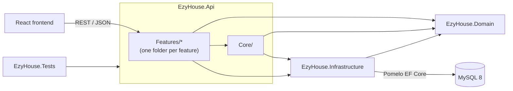
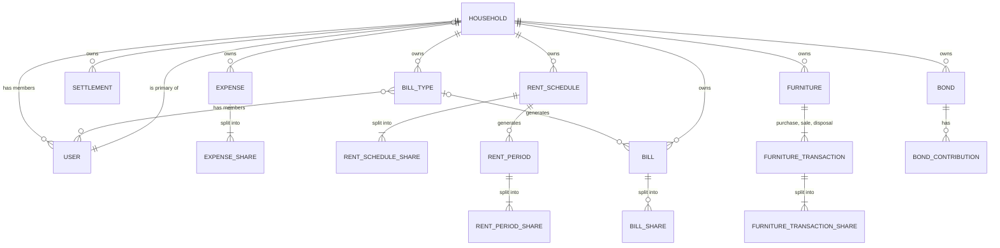

# EzyHouse Backend: Design

The EzyHouse backend is a C# ASP.NET Core Web API on **.NET 10**, backed by MySQL 8 through Entity
Framework Core. The React frontend talks to it over the REST contract in [API.md](../API.md).

**Status:** every API.md endpoint is built and has been called over HTTP against MySQL with the
demo data; 114 NUnit tests pass. To run it, see [README.md](README.md). This document explains how
the code is organised and **why**, so anyone in the team can change it, or explain it in the demo.

## Contents

1. [Inputs](#1-inputs)
2. [Solution layout](#2-solution-layout)
3. [Packages and set-up](#3-packages-and-set-up)
4. [Data model](#4-data-model)
5. [Design decisions](#5-design-decisions)
6. [Endpoint rules](#6-endpoint-rules)
7. [Tests](#7-tests)
8. [Status and remaining work](#8-status-and-remaining-work)
9. [Risks and notes](#9-risks-and-notes)

---

## 1. Inputs

- **[API.md](../API.md) (v4) is the source of truth** for endpoints, request and response shapes,
  permissions and business rules. Where this document and API.md disagree, API.md wins. The rule
  clarifications made while designing the backend were added to API.md itself, still as v4:
  - leaving lists every reason it is blocked
  - the last member to leave keeps the household as an archive
  - rent periods and bill placeholders are only created forward
  - paid dates
  - the bond has no lock
- **[specifications.md](../specifications.md)** supplies the tech stack: an ASP.NET Core Web API,
  MySQL through `Pomelo.EntityFrameworkCore.MySql` with EF Core Code First, NUnit, and the names
  `EzyHouseDbContext` and `EzyHouse.Tests`.
- **[Assignment2_Specification.pdf](../../Research/Assignment2_Specification.pdf)** supplies the
  marking requirements. The README's [technique table](README.md#where-to-find-each-marking-guide-technique)
  shows where each one is met.
- **[knowledge.md](../knowledge.md)** is the C# reference from the lectures.

### Parts of specifications.md that are not built

specifications.md describes an earlier design that API.md v4 replaced. The frontend should follow
API.md, not specifications.md.

- **The `Flatmate` entity and the `RentExpense` / `UtilityBill` / `AdHocExpense` subclasses.** API.md
  has users and households instead; rent, bills and groceries are separate models with different rules.
- **Room-size and percentage splits.** API.md allows only `equal` and `exact`.
- **PayID payment strings, CSV export, notifications (`INotifiable`), debt simplification and
  `GET /api/dashboard/summary`.** None of these are in API.md. The dashboard is built from existing
  endpoints.
- **The generic repository `IRepository<T>`.** Replaced by one repository per feature (5.7).

---

## 2. Solution layout

**Vertical feature slices on a shared Core.** Each feature of the app has one folder holding
everything it needs: controller, service, repository, DTOs and mappings. Inside a slice, the
familiar controller → service → repository flow still applies.

```text
Backend/
  README.md                  how to run it, and where each marking-guide technique is
  backend.md                 this document
  EzyHouse.slnx
  docker-compose.yml         MySQL 8 for development
  src/
    EzyHouse.Domain/         shared Core: entities, enums, interfaces, split / schedule / balance rules,
                             exceptions. References nothing else.
      Entities/  Enums/  Interfaces/  ValueObjects/  Splitting/  Scheduling/  Balances/
      Exceptions/  Extensions/
    EzyHouse.Infrastructure/ shared Core: EzyHouseDbContext, entity configurations, the migration
      Data/  Data/Configurations/  Migrations/
    EzyHouse.Api/
      Core/                  shared by every feature: current user, error handler, JSON settings,
                             [Money], shared DTOs and mappings, rent/bill generation, household
                             balances, SystemClock, DemoSeeder
      Features/
        Auth/  Households/  Expenses/  Balances/  Rent/  Bills/  FurnitureItems/  Bonds/
          each: <X>Controller, I<X>Service + <X>Service, I<X>Repository + <X>Repository,
                <X>Dtos, <X>Mappings, <X>Feature (registers the slice's services)
      Program.cs
  tests/
    EzyHouse.Tests/          Domain/  Core/  Features/  Infrastructure/  Support/
```



Rules that keep the slices independent:

1. **A feature never references another feature's classes.** Anything two features need moves to
   Core. For example, `PaidRequest` is used by both Rent and Bills, so it lives in `Api/Core/SharedDtos.cs`.
2. **Reading another feature's data goes through Core.** Only Balances and leaving the household do
   this. They use `IHouseholdBalances` and `IRecurringChargeGenerator` in `Api/Core/`, never the
   Rent or Balances slice.
3. **One `DbContext`, one migration history.**

Why: a change to one feature touches one folder; the team can split work by feature with few merge
conflicts; each person can explain their own slice end to end in the individual demo. In the
marking guide's terms, this is "high cohesion, low coupling".

**Naming:** the folders are `Households`, `FurnitureItems` and `Bonds`, not singular. A namespace
segment called `Household`, `Furniture` or `Bond` hides the entity class of the same name and gives
compile error CS0118.

---

## 3. Packages and set-up

### Prerequisites

- **.NET 10 SDK.** Visual Studio 2022 can't build .NET 10 projects; use Visual Studio 2026, Rider,
  VS Code or the command line. Whether the lab PCs can build .NET 10 still needs checking (section 8).
- **Docker Desktop** for MySQL 8 (`docker-compose.yml`): database `ezyhouse`, user `ezyhouse`,
  password `admin123`, port 3306.

### NuGet packages

| Project | Package | Version |
|---|---|---|
| Infrastructure | `Pomelo.EntityFrameworkCore.MySql` | 9.0.0 |
| | `Microsoft.EntityFrameworkCore.Relational` | 9.0.0 |
| Api | `Microsoft.EntityFrameworkCore.Design` (for `dotnet ef`) | 9.0.0 |
| | `Microsoft.AspNetCore.Authentication.JwtBearer` | 10.0.12 |
| | `Microsoft.AspNetCore.OpenApi` | 10.0.12 |
| | `Swashbuckle.AspNetCore` (Swagger UI) | 10.3.0 |
| Tests | `NUnit` 4.3.2, `NUnit3TestAdapter` 5.0.0, `NUnit.Analyzers` 4.7.0, `Microsoft.NET.Test.Sdk` 17.14.0, `coverlet.collector` 6.0.4 | |
| | `Microsoft.EntityFrameworkCore.Sqlite` (in-memory test database) | 9.0.0 |

- **EF Core stays on 9.0.x on .NET 10.** Pomelo 9 is the newest MySQL provider and needs EF Core 9;
  every `Microsoft.EntityFrameworkCore.*` package must be the same 9.0.x version, or start-up fails
  with `MissingMethodException`.
- **No BCrypt package.** Passwords use ASP.NET's built-in `PasswordHasher<User>` (5.9).

### Configuration (`src/EzyHouse.Api/appsettings.json`)

- **`ConnectionStrings:EzyHouse`:** the MySQL database from `docker-compose.yml`.
- **`Jwt`:** `Issuer` `ezyhouse`, `Audience` `ezyhouse-web`, a signing `Key`, and `ExpiryMinutes`
  1440 (24 hours).
- **`Cors:AllowedOrigins`:** `http://localhost:5173`, the React dev server.

The password and signing key are demo-only values, committed so the tutor can run the app straight
away. Never reuse them anywhere real.

### Wiring in `Program.cs`

In order:

1. `EzyHouseDbContext` on MySQL. The server version is pinned to 8.0.36, so design-time tools don't
   need a live connection.
2. **JSON** through `ApiJsonOptions.Apply` (5.8): camelCase, enums as lowercase strings, money
   always written with two decimal places.
3. **Errors:** `AddProblemDetails()` and `AppExceptionHandler` (5.8).
4. **JWT bearer** authentication, with `MapInboundClaims = false` so the user id stays in `sub`.
   An `OnMessageReceived` event reads the token from the `ezyhouse_token` cookie (`AuthCookie`)
   when the request has no `Authorization` header, so the header wins (5.9).
5. **Authorization fallback policy:** every endpoint needs a signed-in user unless it opts out
   with `[AllowAnonymous]`. Only register, login and logout opt out.
6. **CORS** for the React dev server.
7. **Shared services:**
   - singletons: `IClock` → `SystemClock`, both `ISplitStrategy` classes, `SplitCalculator`, `BalanceCalculator`
   - scoped: `ICurrentUserContext`, `IRecurringChargeGenerator`, `IHouseholdBalances`
8. **One line per slice:** `AddAuthFeature(configuration)`, `AddHouseholdsFeature()`,
   `AddExpensesFeature()`, `AddBalancesFeature()`, `AddRentFeature()`, `AddBillsFeature()`,
   `AddFurnitureFeature()`, `AddBondsFeature()`.
9. **Swagger** with a Bearer security definition, so the **Authorize** button can send a token.
10. **In Development only:**
    - `Database.Migrate()` creates or upgrades the schema
    - `DemoSeeder.SeedAsync` adds the demo data when the `Users` table is empty
    - Swagger UI is switched on

### Migrations

There is one migration, `20261014232930_InitialCreate`. Because Development start-up calls
`Migrate()`, pulling the latest code and running the API brings anyone's database up to date. To
add a migration after changing an entity or configuration:

```bash
dotnet ef migrations add <Name> --project src/EzyHouse.Infrastructure --startup-project src/EzyHouse.Api
```

---

## 4. Data model

The schema is built Code First:
- entity classes live in `EzyHouse.Domain/Entities/`
- keys, indexes and relationships are set in `IEntityTypeConfiguration<T>` classes in `EzyHouse.Infrastructure/Data/Configurations/`
- the migration creates the MySQL tables

### Conventions

- **Keys:** every entity has an auto-increment `int Id`.
- **Money:** `decimal`, stored as MySQL `DECIMAL(10,2)` (`HasMoneyPrecision()`). Never `double`.
  Responses always show two decimal places (`500.00`).
- **Dates:** `DateOnly` → MySQL `DATE` → JSON `YYYY-MM-DD`.
- **Enums:** stored as strings so rows are readable in MySQL Workbench; JSON uses lowercase strings.
  `SplitType` (equal, exact), `Frequency` (weekly, fortnightly, monthly, quarterly), `BillStatus`
  (pending, submitted), `FurnitureStatus` (owned, sold, disposed).
- **Household scoping:** every top-level household record implements `IHouseholdOwned`
  (`int HouseholdId`), so its queries can use `ForHousehold` (5.6). Child records have no household
  column of their own and are reached through their parent:
  - rent periods through their schedule
  - furniture transactions through their item
  - bond contributions through their bond
- **Users are never deleted.** Every foreign key to `User` is `Restrict`, including the
  `BillTypeMembers` join table. Leaving a household only clears `User.HouseholdId`, so names stay
  in the history.
- **Lifecycle fields have private setters** (5.4), so they can only change through an entity
  method. EF Core still loads and saves them.

### Shares

API.md uses three share shapes. Two are stored, as **owned collections** (`OwnsMany`), each in its
own table:

- **`Share` { `UserId`, `Amount` }:** owned by `Expense` (`ExpenseShares`), `RentSchedule`
  (`RentScheduleShares`) and `FurnitureTransaction` (`FurnitureTransactionShares`).
- **`PaidShare` { `UserId`, `Amount`, `Paid`, `PaidDate?` }:** owned by `RentPeriod`
  (`RentPeriodShares`) and `Bill` (`BillShares`).
- **`ShareInput` { `userId`, `amount?` }** is only a request shape and is never stored.

Each share table's primary key is **(owner id, `UserId`)**, so the database itself prevents a person
appearing twice in one split. Shares always store the **calculated** amount, even for equal splits,
so later rule changes never rewrite history.

### Entities

| Entity | Fields | Notes |
|---|---|---|
| `User` | `Id`, `Name`, `Email` (unique), `PasswordHash`, `HouseholdId?` | A user is in at most one household. |
| `Household` | `Id`, `Name`, `InviteCode` (unique, 8 characters), `PrimaryUserId`, `Members` | Kept as an archive when its last member leaves. |
| `Expense` | `Id`, `HouseholdId`, `Description`, `Amount`, `Date`, `PaidByUserId`, `CreatedByUserId`, `SplitType`, `Shares` | `IBalanceContributor` |
| `Settlement` | `Id`, `HouseholdId`, `FromUserId`, `ToUserId`, `Amount`, `Date`, `CreatedByUserId` | `IBalanceContributor`. Never updated or deleted. |
| `RentSchedule` : `RecurringSchedule<RentPeriod>` | `Id`, `HouseholdId`, `Amount`, `Frequency`, `StartDate`, `EndDate?`, `SplitType`, `Shares` | Deleting a schedule cascades to its periods. |
| `RentPeriod` | `Id`, `ScheduleId`, `StartDate`, `EndDate`, `Amount`, `PayeeUserId`, `Shares` (paid shares) | Unique `(ScheduleId, StartDate)` |
| `BillType` : `RecurringSchedule<Bill>` | `Id`, `HouseholdId`, `Name`, `Frequency`, `StartDate`, `EndDate?`, `Members` | Many-to-many with `User` through `BillTypeMembers` |
| `Bill` | `Id`, **`HouseholdId`**, `BillTypeId?`, `BillTypeName`, `DueDate`, `Status`, `Amount?`, `PayeeUserId?`, `SubmittedDate?`, `Shares` | Unique `(BillTypeId, DueDate)`; FK to the type is `SetNull` |
| `Furniture` | `Id`, `HouseholdId`, `Name`, `Status`, `CreatedByUserId`, `Transactions` | Computed `Purchase`, `Sale`, `Disposal` |
| `FurnitureTransaction` (abstract): `FurniturePurchase`, `FurnitureSale`, `FurnitureDisposal` | `Id`, `FurnitureId`, `Date`, `Amount`, `CounterpartyUserId`, `SplitType`, `Shares` | One table (TPH) with a `Kind` column; unique `(FurnitureId, Kind)`. `IBalanceContributor` |
| `Bond` | `Id`, `HouseholdId`, `Total`, `PaidDate`, `Contributions` | Computed `Outstanding = Total − Σ contributions` |
| `BondContribution` | `Id`, `BondId`, `UserId`, `Amount`, `Date` | |

- **`Bill` has its own `HouseholdId`:**
  - Deleting a bill type deletes its pending placeholders.
  - The database sets `BillTypeId` to null on its submitted bills, which stay as history and keep their copied `BillTypeName`.
  - Without its own household column, such a bill could no longer be filtered to its household.
  - API.md's `billType.id` can therefore be `null`.
- **`CounterpartyUserId`** is the person who paid, for a purchase or disposal, or the person who
  received the cash, for a sale.

### ER diagram



Every share table also has a `UserId` foreign key to `USER`; those links are left out to keep the
diagram readable.

---

## 5. Design decisions

One subsection per design question. Each one gives the decision, the main code, why it was chosen,
and what was rejected. Where a technique from the marking guide shows up, the README's
[technique table](README.md#where-to-find-each-marking-guide-technique) has the file path.

### 5.1 Splitting money: Strategy

**Decision:** one class per split rule, picked by `splitType`. Every split in the app goes through
`SplitCalculator`: expenses, rent schedules, bill submissions and furniture.

```csharp
public interface ISplitStrategy
{
    SplitType Type { get; }
    IReadOnlyList<Share> Split(decimal total, IReadOnlyList<ShareInput> shares);
}

public sealed class SplitCalculator(IEnumerable<ISplitStrategy> strategies)
{
    private readonly Dictionary<SplitType, ISplitStrategy> byType = strategies.ToDictionary(strategy => strategy.Type);

    public IReadOnlyList<Share> Split(decimal total, SplitType type, IReadOnlyList<ShareInput> shares, IReadOnlySet<int> memberIds)
    {
        // shared rules first (400): at least one person, nobody twice, everyone a current member
        …
        return strategy.Split(total, shares);   // then the rule for this split type
    }
}
```

- **`EqualSplitStrategy`:** rounds down to the cent and gives the leftover cents to the first share.
  For example, $100.00 three ways gives 33.34, 33.33 and 33.33.
- **`ExactSplitStrategy`:** every share needs an amount that is not negative and has at most 2
  decimals, and the shares must add up to the total. Otherwise it returns 400.

**Why:** each rule has its own validation and its own tests, and it is the clearest genuine example
of interface polymorphism. Rule of thumb for the demo: **composition** (Strategy) when the behaviour
is a runtime choice, like `splitType`; **inheritance** when it depends on what the object is (5.2).
To be honest, the "easy to add a split type" benefit is mostly hypothetical, because API.md rules
out new split types.

### 5.2 Recurring rent and bills: create on read, Template Method + Factory Method

**Decision:**
- Rent periods and bill placeholders are **created when someone reads them** (`GET /api/rent-periods`, `GET /api/bills`).
- A generic base class holds the shared steps; each subclass fills in one step.

```csharp
public abstract class RecurringSchedule<TOccurrence> : IHouseholdOwned
{
    public IEnumerable<ScheduleSlot> GetSlots(DateOnly upTo) { … yield return … }   // iterator

    // Template method: the fixed steps. Forward-only: nothing before what already exists.
    public List<TOccurrence> GenerateMissing(DateOnly? lastCoveredDate, DateOnly today, int primaryUserId) =>
        GetSlots(today)
            .Where(slot => lastCoveredDate is null || slot.Start > lastCoveredDate)
            .Select(slot => CreateOccurrence(slot, primaryUserId))
            .ToList();

    // Factory method: the one step each subclass fills in
    protected abstract TOccurrence CreateOccurrence(ScheduleSlot slot, int primaryUserId);
}
// RentSchedule : RecurringSchedule<RentPeriod> → a period with copied shares; payee = current primary, whose share is ticked
// BillType     : RecurringSchedule<Bill>       → a pending placeholder with the type's name copied
```

- **Dates are anchored to the start date** (`StartDate.AddFrequency(frequency, step)`), never to the
  previous slot. This avoids month-end drift: a monthly schedule from 31 Jan gives 28 Feb, then 31 Mar.
  `AddFrequency` is an extension method backed by a dictionary of delegates.
- **Forward-only after edits:**
  - Rent passes the latest period's end date; bills pass the latest due date.
  - Moving a start date or changing the frequency never back-fills past periods. Only new ones follow the new settings.
- **Paid date:** the primary's own rent share is ticked automatically, dated the **first day of the
  period**. Catching up six weeks would otherwise stamp every period with the same date. A bill's
  payee share is dated the day it is submitted.
- **Two requests at once:** `Api/Core/RecurringChargeGenerator` saves through the unique indexes
  `(ScheduleId, StartDate)` and `(BillTypeId, DueDate)`. If another request already created the same
  entry, the duplicate insert is dropped.
- **Next due date:** `GetNextDueDate` looks ahead from today, or from the start date if that is later.

**Why create on read:**
- No background job to host.
- It catches up after downtime and can't miss a run.
- A scheduled job (`BackgroundService`, Hangfire) would only pay off for reminders or automatic payments, which aren't in scope. It is still the upgrade path: it would call the same `GenerateMissing`.

**Why inheritance here:** what varies depends on *what the schedule is*, never changes at runtime,
and needs only the schedule's own data.

### 5.3 Balances: calculated on every read, interface polymorphism

**Decision:**
- Balances are never stored.
- Each record that affects them reports who owes whom; one calculator nets them.
- They include **expenses, furniture and settlements only**. Rent, bills and the bond are tracked separately (API.md).

```csharp
public record LedgerEntry(int DebtorId, int CreditorId, decimal Amount);
public interface IBalanceContributor { IEnumerable<LedgerEntry> GetLedgerEntries(); }
```

| Record | Who owes whom |
|---|---|
| `Expense`, `FurniturePurchase`, `FurnitureDisposal` | each person in the split owes the payer their share |
| `FurnitureSale` | the person who received the cash owes each other person their share (the override reverses it) |
| `Settlement` | `from` paid `to`, giving an entry with debtor = `to` and creditor = `from`, which cancels that much |

`BalanceCalculator` groups the entries **per pair of people** and nets each pair; there is no debt
simplification. Net per member = what others owe you − what you owe; the nets always add up to 0.
For API.md's couch example (bought for $600 by Alice, sold for $300 to Cara, split three ways), the
debts are Bob → Alice $200, Cara → Alice $300 and Cara → Bob $100.

`Api/Core/HouseholdBalances` loads the three kinds of record and runs the calculator. It is used by
`GET /api/balances` and by the leave check. A debt can name someone who has already left, so the
balance response looks up every user it mentions, not just current members.

**Why:**
- Expenses and furniture can be edited and deleted, which is exactly what makes stored balances drift.
- A household has at most a few hundred records.
- Rejected: a stored running balance (fragile); a double-entry ledger (the upgrade path for thousands of records); a `switch` on type.

### 5.4 Lifecycle rules: methods on the entities

**Decision:**
- Each rule about *whether the record's state allows something* is a method on the entity.
- The fields it protects have private setters.

```csharp
furniture.RecordSale(sale);                    // not owned → 409; Status = Sold
furniture.RecordDisposal(disposal);            // not owned → 409; Status = Disposed
furniture.Edit(name, purchase);                // not owned → 409
bill.Submit(amount, shares, payeeId, today);   // already submitted → 409; payee's share ticked
bill.SetSharePaid(userId, paid, today);        // still pending → 409
period.SetSharePaid(userId, paid, today);      // not in the split → 404
share.SetPaid(paid, today);                    // unticking clears PaidDate
bond.Update(total, paidDate, contributions);   // contributions > total → 400
```

- `RecordSale` and `RecordDisposal` are not called `Sell` and `Dispose`, because `Dispose` means
  `IDisposable` in .NET.
- **No bond lock:** the primary can always edit the bond (API.md's open question, now resolved).
- *Who* may do something (creator, primary, that person) is a permission check in the service
  (5.6). *Whether the state allows it* lives on the entity.

**Why:** the "owned only" rule is written once instead of in edit, sell and dispose, and it can't be
bypassed by setting `Status` directly. Rejected: the State pattern (three classes per entity to
express one `if`) and state-machine libraries (built for far bigger workflows).

### 5.5 Leaving the household: five checks, every reason reported

**Decision:** `HouseholdService.LeaveAsync` steps:
1. **Create any due rent periods.** Otherwise rent for a period nobody has opened yet would be missed.
2. **Load one `LeaveSituation`** through Core: debts, unpaid rent, active schedules, unpaid bills, member count.
3. **Run five private checks.**
4. **Report every problem in one 409.**

```csharp
List<string> problems = new[]
{
    OpenDebtsProblem(situation), UnpaidRentProblem(situation), ActiveRentScheduleProblem(situation),
    UnpaidBillsProblem(situation), PrimaryWithOthersProblem(situation),
}.OfType<string>().ToList();

if (problems.Count > 0)
    throw new BusinessRuleException(string.Join(" ", problems));
```

The five checks:
1. **Open debts:** the user appears in any pairwise debt, as payer or payee. This uses the debts,
   not the net balance: two debts that cancel out still leave someone unpaid.
2. **Unpaid rent:** a share the user owes is unpaid, or the user is the payee of a period with an
   unpaid share. `UnpaidRentProblem` holds the explicit `delegate` anonymous method for the marking guide.
3. **Active rent schedule:** the user is in the shares of a schedule that hasn't ended.
4. **Unpaid bills:** the same as rent, for submitted bills.
5. **Primary with others:** the primary must hand over first.

**On success:** the user is removed from every bill type's members and `HouseholdId` is cleared, in
one save. Furniture shares stay as history. **If the last member leaves, the household is kept as an
archive**: its history stays, and its invite code stops working (joining returns 404).

**Why:**
- *Private methods rather than one class per check:* fewer files, at the cost of testing the checks only through the service.
- *Every reason at once:* so the user can fix everything in one go.
- *Archive on last leave:* deleting everything is irreversible; forbidding it would trap the user.

### 5.6 Who may do what, and keeping data inside a household

**Decision:**
- Permission checks live in the services, using `ICurrentUserContext` from Core.
- Every query is filtered by household with `ForHousehold`.

```csharp
Household household = await currentUser.RequireHouseholdAsync();   // 401 no user, 403 no household
Household household = await currentUser.RequirePrimaryAsync();     // …and 403 if not the primary

public static IQueryable<T> ForHousehold<T>(this IQueryable<T> query, int householdId)
    where T : IHouseholdOwned =>
    query.Where(item => item.HouseholdId == householdId);
```

- `Require…Async()` is the first line of every service method. It returns the caller's household
  with its members and primary loaded, so it is used for both the check and the work. The one
  exception is `GET /api/household`, which returns 404 when you aren't in a household, as API.md says.
- Another household's record is **404**, not 403, so the API doesn't reveal that it exists.
  Because the record is loaded before the creator check, API.md's order (404 before 403) falls out
  naturally.
- The authorization fallback policy makes login the default for every endpoint, so a forgotten
  `[Authorize]` can't open one up.

**Why not ASP.NET authorization policies:**
- 9 of the 20 endpoints with a rule beyond membership depend on the specific record (its creator, that person, the payer or receiver), so services would need checks anyway, and the rules would be split across two places.
- Rejected: EF Core global query filters. They are invisible when reading a query and must be switched off for login, joining and seeding.

### 5.7 Data access: one repository per feature

**Decision:** each feature has its own repository interface, offering only what that feature may
do. The only shared part is saving.

```csharp
public interface IRepository { Task SaveChangesAsync(); }        // Domain/Interfaces

public interface ISettlementRepository : IRepository              // Features/Balances
{
    Task<IReadOnlyList<Settlement>> ListAsync(int householdId);
    Task<IReadOnlyDictionary<int, User>> FindUsersAsync(IEnumerable<int> userIds);   // names in debts, even of people who left
    void Add(Settlement settlement);                               // no update, no delete
}
```

**Why:**
- `ISettlementRepository` has no update or delete, so API.md's "settlements can't be undone" is enforced by the compiler.
- A generic repository would offer add, delete and get-by-id on everything, including operations the contract forbids.
- `SaveChangesAsync` saves everything changed in the request (the `DbContext` is the unit of work), so leaving saves the user and their bill-type memberships together.
- specifications.md's `IRepository<T>` was its example of generics. Generics now come from `RecurringSchedule<TOccurrence>`, `ForHousehold<T>`, `Dictionary<SplitType, ISplitStrategy>` and `PasswordHasher<User>`.

### 5.8 Errors, validation and JSON

**Decision:** services throw exceptions, and one central handler writes the response.

```csharp
public abstract class AppException(string message) : Exception(message)
{
    public abstract int StatusCode { get; }
    public abstract string Title { get; }
}
// ValidationFailedException 400 · UnauthorizedException 401 · ForbiddenException 403
// NotFoundException 404 · BusinessRuleException 409
```

- **`AppExceptionHandler`:**
  - Turns any `AppException` into a ProblemDetails response (API.md's error shape).
  - Anything else becomes a 500, with no stack trace outside Development.
  - The 400 class is named `ValidationFailedException` so it doesn't clash with `System.ComponentModel.DataAnnotations.ValidationException`.
- **Input checks are attributes on the request DTOs' constructor parameters:** `[Required]`,
  `[StringLength]`, `[EmailAddress]`, `[MinLength]` and the custom `[Money]`. `[Money]` means more
  than 0, at most 99,999,999.99, and at most 2 decimals; `AllowZero` permits a $0 disposal.
  `[ApiController]` returns one 400 listing every bad field.
  ```csharp
  public sealed record RegisterRequest(
      [Required, StringLength(100, MinimumLength = 1)] string? Name,
      [Required, EmailAddress, StringLength(256)] string? Email,
      [Required, MinLength(8), StringLength(100)] string? Password);
  ```
  Put the attributes on the parameters with no `property:` prefix. With the prefix, every POST
  and PUT fails with 500.
- **Rules that need other fields or the database stay where they belong:**
  - exact shares must add up: the split strategy
  - contributions can't exceed the total: `Bond.Update`
  - the payer must be a member: the service
- **JSON (`Api/Core/ApiJsonOptions.cs`):**
  - **Enums:** lowercase strings; a number such as `7` is rejected with 400.
  - **Money in responses:** always exactly two decimal places (`TwoDecimalPlacesConverter`), whether the value came from the request (`500`) or from MySQL (`500.00`).
  - **Reading** is left untouched, so `10.505` still reaches `[Money]` and is rejected.

**Why:**
- *Exceptions:* controllers stay one line each. Rejected: `Result<T>` objects, which need a check at every step, and a failure can be silently ignored.
- *Attributes:* no extra package. Rejected: FluentValidation, which pays off with many conditional rules.

### 5.9 Login: our own small login, not ASP.NET Identity

**Decision:**
- Our own `Users` table.
- Passwords hashed with ASP.NET's built-in `PasswordHasher<User>`, registered in `AuthFeature`. It ships with ASP.NET, so no package is needed.
- `JwtTokenService` issues a token with `sub` (user id), `name` and `email`, valid for `Jwt:ExpiryMinutes` (1440, 24 hours).
- Register and login return the token in the JSON **and** set it as the cookie `ezyhouse_token`: HttpOnly, SameSite=Strict, Path=/, Max-Age equal to the token lifetime, and Secure only when the request is HTTPS (Safari refuses Secure cookies on `http://localhost`). The name and options live in `AuthCookie`.
- The API takes the token from the `Authorization: Bearer` header first and falls back to the cookie, so Swagger's **Authorize** button keeps working.
- `POST /api/auth/logout` deletes the cookie with the same options, so the browser really removes it. Tokens are stateless, so a copied token stays valid until it expires.
- Emails are stored in lower case.

**Why:** ASP.NET Identity's ready-made endpoints don't match API.md: different URLs, register
returns no token, and the response shapes and tokens differ. It also adds about seven unused tables.
Its extras (lockout, password reset, email confirmation) aren't in scope.

**Why a cookie:** the React app never touches the token, so script injected into the page can't
read it. **CSRF:** SameSite=Strict means the browser doesn't send the cookie on requests started
by another site, and every write takes a JSON body, which a plain cross-site form can't send.
Rejected: antiforgery tokens, which add a token round trip and a header on every write for no gain
in a same-origin app.

---

## 6. Endpoint rules

API.md has the request and response shapes. This section lists the rules each feature enforces,
beyond the shared ones in section 5:

- **Login (401):** login is required everywhere except register, login and logout.
- **Household (403):** you must be in a household for every household endpoint.
- **404 for missing records:** a record that doesn't exist, or belongs to another household, is 404.
- **Splits:** every split goes through `SplitCalculator`.

### Auth (`Features/Auth`)

- **`POST /api/auth/register`:**
  - A duplicate email is 409.
  - The password must be at least 8 characters.
  - Returns a token and the user, and sets the `ezyhouse_token` cookie.
- **`POST /api/auth/login`:** an unknown email or a wrong password gives the same 401 message. On
  success it returns a token and the user, and sets the cookie.
- **`POST /api/auth/logout`:** clears the cookie and returns 204. Works without being logged in.
- **`GET /api/me`:** returns the user, or 401 if the token's user no longer exists.

### Household (`Features/Households`)

- **Create (`POST /api/household`):**
  - 409 if you're already in a household.
  - The invite code is 8 characters from `ABCDEFGHJKLMNPQRSTUVWXYZ23456789`, with no `0`/`O` or `1`/`I`. It is redrawn if already taken.
  - You become the primary.
- **`GET /api/household`:** 404 when you aren't in a household.
- **Join (`POST /api/household/join`):**
  - An unknown code, or an archived household, is 404.
  - 409 if you're already in a household.
  - New members aren't added to rent or bills automatically.
- **Hand over (`PUT /api/household/primary`):**
  - Primary only (403); the new primary must be a member (400).
  - Any due rent periods are created first, so unpaid shares stay owed to the outgoing primary.
- **Leave (`POST /api/household/leave`):** see 5.5.

### Expenses (`Features/Expenses`)

- **List:** newest first.
- **Create and edit:**
  - The payer must be a current member (400).
  - An edit replaces every field and recalculates the shares.
- **Edit and delete:** only the creator (403).

### Balances and settlements (`Features/Balances`)

- **`GET /api/balances`:**
  - Lists current members' nets and the pairwise debts (5.3).
  - Rent, bills and the bond are excluded.
- **`POST /api/settlements`:**
  - Both people must be current members and different (400).
  - Only the payer or the receiver may record it (403).
  - The date is today; any positive amount is allowed.
- **No update or delete.**

### Rent (`Features/Rent`)

- **Schedules:**
  - Writing is primary only (403).
  - `endDate` must be on or after `startDate` (400).
  - Edits affect only new periods (5.2).
  - Deleting a schedule deletes its periods.
- **`GET /api/rent-periods`:** creates due periods first (5.2), then lists them.
- **`PUT /api/rent-periods/{id}/shares/{userId}`:**
  - Only that person or the primary (403); a person not in the split is 404.
  - Ticking sets today's date; unticking clears it.

### Bills (`Features/Bills`)

- **Bill types:**
  - Writing is primary only (403).
  - Members must be current members (400).
  - `endDate` must be on or after `startDate` (400).
  - Deleting a type deletes its pending bills and keeps the submitted ones as history.
- **`GET /api/bills?status=`:**
  - Creates due placeholders first.
  - `status` is `pending` or `submitted`; anything else is 400.
- **Submit (`POST /api/bills/{id}/submit`):**
  - Primary only (403); a second submit is 409.
  - `equal` splits across the type's current members, ordered by id.
  - `exact` needs `shares`.
  - The payee's own share is ticked with today's date.
- **`PUT /api/bills/{id}/shares/{userId}`:**
  - Only that person or the primary (403).
  - A pending bill is 409; a person not in the split is 404.

### Furniture (`Features/FurnitureItems`)

- **`GET /api/furniture?status=`:** `owned`, `sold` or `disposed`; anything else is 400.
- **Create:** any member can add an item, with its purchase split.
- **Edit, delete, sell and dispose:**
  - Only the creator or the primary (403).
  - Edit, sell and dispose need the item to be owned (409); the status only moves forward.
  - A disposal may cost $0.
- **Balances:** deleting an item removes its transactions, and so its effect on balances.

### Bond (`Features/Bonds`)

- **Reading:** any member.
- **Create, edit and delete:**
  - Primary only (403).
  - Contributors must be current members (400).
  - Contributions can't add up to more than the total (400).
  - An edit replaces the whole contribution list.
- **Balances:** the bond never affects them.

### Dashboard

There is no endpoint, by design. The frontend combines `GET /api/balances`, `GET /api/rent-periods`,
`GET /api/bills` and `GET /api/furniture?status=owned` (API.md "Dashboard").

### Demo data (`Api/Core/DemoSeeder.cs`)

Seeded in Development, only when the `Users` table is empty. The contents are listed in the
[README](README.md#demo-data). The couch matches API.md's example, and the dates are relative to
the seeding day, so rent periods and bills are always due.

---

## 7. Tests

114 NUnit tests, written as Arrange-Act-Assert with `Assert.That(actual, Is.EqualTo(expected))`.
Run them with `dotnet test EzyHouse.slnx`, or from Test Explorer.

| Folder | Tests | What they cover |
|---|---|---|
| `Domain/` | 34 | pure rules, no database: equal and exact splits, `SplitCalculator`, `AddFrequency`, schedule slots and month-end anchoring, forward-only generation, balances (incl. the couch and cancelling debts), lifecycle methods, `HasAtMostTwoDecimals` |
| `Features/` | 71 | each feature's service against a real database: its permission checks (403), another household's records (404), its business rules (409), and every leave check; the login cookie set by register/login and cleared by logout |
| `Core/` | 7 | rent/bill generation and household balances against a real database; the API's JSON settings |
| `Infrastructure/` | 2 | the model builds; household scoping |

- **The test database is real EF Core on in-memory SQLite** (`Support/TestDb`). A fresh database is
  created for each test with `EnsureCreated()`. Unlike EF's InMemory provider, SQLite enforces
  foreign keys and unique indexes, so duplicate prevention and delete rules are really tested.
- **Helpers:**
  - `Support/FixedClock`: a fixed "today", so date rules give stable results
  - `Support/TestHousehold`: builds a household with members
  - `Support/TestUsers.SignIn`: acts as a given user
- **SQLite can't `SUM` or `ORDER BY` a `decimal` column in SQL.** Keep money arithmetic in C# after
  loading, as `BalanceCalculator` and `Bond.Outstanding` do, and sort by date or id in queries.

---

## 8. Status and remaining work

**Done:** every API.md endpoint, the 114 tests, demo data, and the README with run steps and the
technique table.

**Still to do, before Friday 16 October 2026, 11:59pm:**

1. **Lab check.** Confirm whether the lab PCs can build .NET 10. If not, there are two fallbacks:
   - demo on a laptop
   - retarget all four projects to `net9.0` with the ASP.NET packages on 9.0.x; the code builds and the tests pass on .NET 9
2. **Frontend run-through.** Exercise every API.md endpoint from the React app.
3. **Clean-machine run.** A teammate who didn't write the code follows the README alone.
4. **Push and submit.** Push once the team agrees, then build the submission zip and write the
   report's backend paragraphs.

---

## 9. Risks and notes

- **Lab environment.** The demo is marked in the lab and the code must compile there (section 8).
  The lab also needs MySQL, or Docker, or a laptop.
- **Package versions.** Keep every EF Core package on the same 9.0.x as Pomelo. A
  `MissingMethodException` or `TypeLoadException` at start-up almost always means a mismatch.
- **What "today" means.** Every date rule uses `IClock`, which is the server's local date. Lab and
  laptop clocks are on Sydney time. Never use `DateTime.UtcNow` for business dates: near midnight it
  gives yesterday or tomorrow.
- **Concurrent generation** is handled by the unique indexes (5.2).
- **Secrets.** The committed database password and JWT key are for the demo only.
- **The individual demo.** Everyone should be able to explain:
  - `SplitCalculator` (5.1)
  - `RecurringSchedule<T>` (5.2)
  - `BalanceCalculator` (5.3)
  - the leave checks (5.5)
  - their own feature's slice end to end
